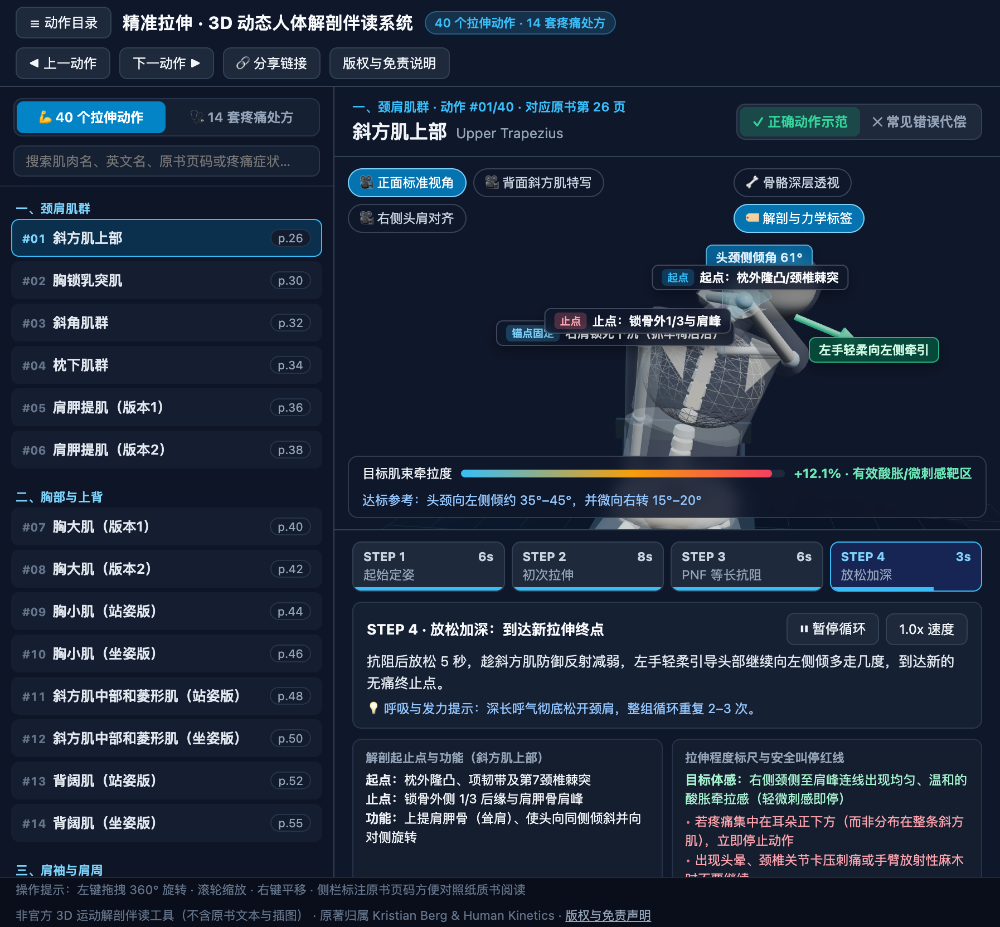
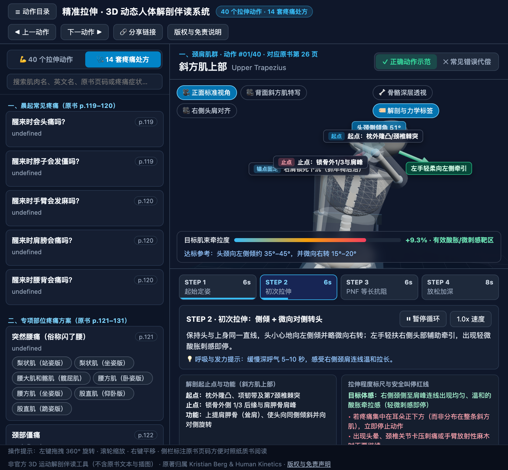
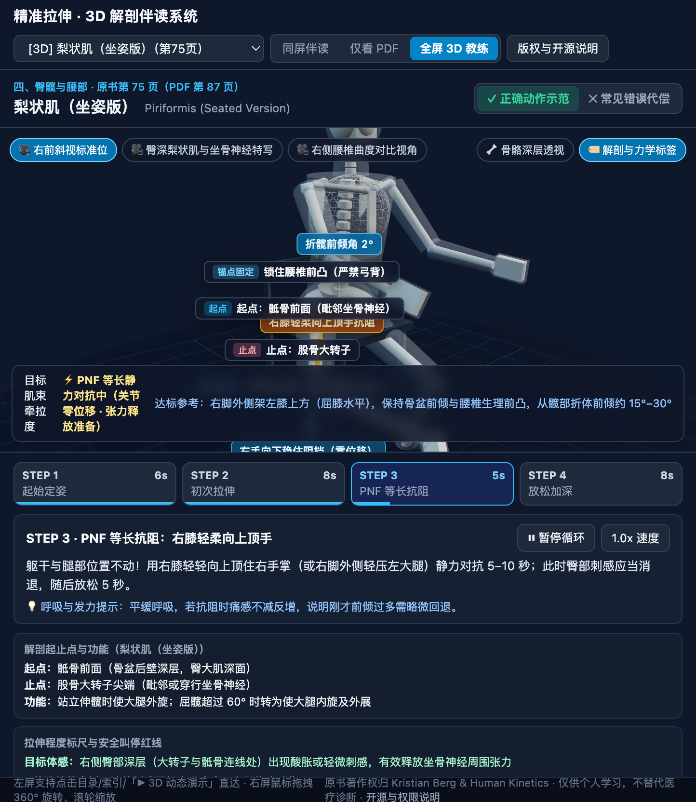
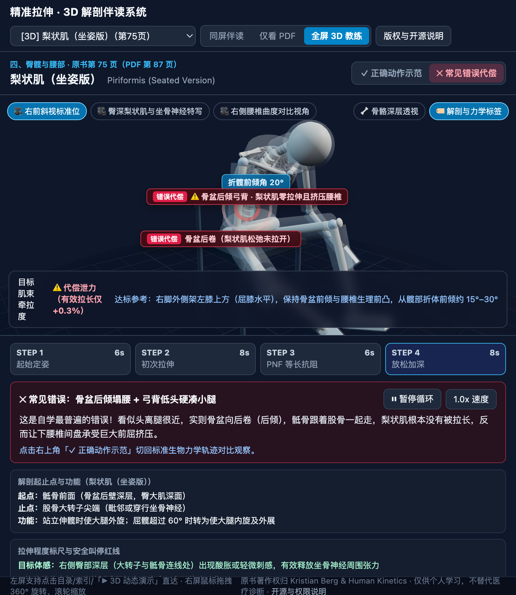

# 精准拉伸 · 3D 动态人体解剖伴读系统

**在线预览（GitHub Pages）**：<https://chengzhihuang.github.io/prescriptive-stretching-3d/>

本项目是为阅读《精准拉伸》（*Prescriptive Stretching*, Kristian Berg / Human Kinetics, 2011）的自学者打造的一款**纯 3D 动态人体肌肉解剖与 PNF 伴读 Web 应用**（不含原书 PDF、原文或原书插图，标注对应原书页码方便对照纸质书或正版电子书学习）。

针对看静态插图自学时的三大痛点——**分不清深层目标肌肉起止点、拿捏不准关节角度与牵拉程度、看不懂 PNF（收缩—放松法）“用力对抗但关节零位移”的静力过程**——本系统基于 Three.js 正向运动学骨骼树与程序化三维纺锤肌束引擎，实现了全书 **40 个针对性拉伸动作**与 **14 套疼痛缓解处方**的交互式三维演示。

---

## 核心功能亮点

- **全书 40 个拉伸动作 100% 三维动态覆盖**：按颈肩（6个）、胸部与上背（8个）、肩袖与肩周（5个）、臀髋与腰部（7个）、大腿（6个）、小腿与上肢（8个）完整收录，每项均标明原书对应页码（`p.26–p.116`）。
- **三维解剖起止点肌束与深层骨骼透视**：按真实骨性**起点（Origin）→ 绕行支点 → 止点（Insertion）**实时生成纺锤形肌腹与象牙白肌腱（及毗邻坐骨神经干等结构），随关节运动实时计算拉长百分比并动态映射张力色彩；支持一键开启 **`🦴 骨骼深层透视`** 观察冈上窝、冈下窝、胸小肌、腰方肌、梨状肌等深层肌群。
- **PNF 四阶段读秒循环与静力抗阻双向力矢量**：将静态动作还原为 `① 起始定姿` → `② 初次拉伸` → `③ PNF 等长抗阻` → `④ 放松加深` 四步跟练时间轴；在抗阻阶段同时渲染**琥珀色主动发力箭头 + 冰蓝色支点反作用力箭头**，直观拆解等长静力对抗。
- **「✓ 正确动作示范 vs ✕ 常见错误代偿」一键对比**：内置全书 40 个动作的常见错误代偿模型（如耸肩泄力、骨盆后倾塌腰弓背、屈髋撅臀、屈膝丢张力等），实时显示代偿泄力比例与关节异常受压警示环。
- **14 套疼痛缓解处方联动导览**：覆盖晨起常见不适（晨起头痛、落枕、手麻、肩痛、腰背痛）与专项部位疼痛（闪腰、颈部僵痛、紧张型头痛、上背痛、网球肘、跑步膝等），点击症状即可筛选并一键切换整套处方动作序列。

---

## 界面预览

### 1. 主界面：左侧 40 动作伴读目录 + 右侧全幅 3D 动态解剖舞台


### 2. 14 套疼痛缓解处方导览与骨骼深层透视


### 3. PNF 等长抗阻阶段：起止点标注、坐骨神经透视与双向力矢量


### 4. 「常见错误代偿」对比：骨盆后卷弓背导致目标肌泄力与腰椎受压警示


---

## 网页使用说明

1. **检索与切换动作 / 处方（左侧伴读目录）**：
   - 切至 **`💪 40 个拉伸动作`** 标签：按 6 大身体部位浏览全部动作，右侧 `p.XX` 对应原书页码；顶部搜索框支持按中文肌肉名、英文名、序号或页码实时过滤。
   - 切至 **`🩺 14 套疼痛处方`** 标签：点击任意疼痛症状卡片，视口顶部即会出现该症状的**处方动作序列芯片条**，可按顺序逐个点击跟练。
   - 点击左上角 `☰ 动作目录` 可随时收起侧栏，进入无遮挡全屏 3D 视野。
2. **三维观察与透视交互（中央 3D 视口）**：
   - **鼠标/触控操作**：左键（或单指）拖拽 **360° 自由旋转**、滚轮（或双指）**缩放**、右键拖拽 **平移**；
   - **预设机位**：视口左上角为每个动作提供 **3 个最佳解剖观察视角**（如正面标准位、背面深层肌窝特写、侧面脊柱与骨盆曲度核对）；
   - **透视与标签**：右上角可一键切换 `🦴 骨骼深层透视` 与 `🏷️ 解剖与力学标签`。
3. **PNF 四步跟练与正误对比（底部控制台）**：
   - 点击标题栏右侧 **`✕ 常见错误代偿`** 与 **`✓ 正确动作示范`** 对比正确与代偿生物力学差异；
   - 底部 `STEP 1–4` 进度卡片默认自动循环读秒跟练，点击任一卡片可定格到该阶段仔细观察发力箭头与角度弧，支持 `⏸ 暂停循环` 与 `0.5x / 1.0x / 1.5x` 倍速调节；
   - 最下方常驻展示该肌肉的 **起点 / 止点 / 功能** 以及 **目标体感区间与安全叫停红线**。
4. **URL 深链直达（Hash Routing）**：
   - 点击右上角 `🔗 分享链接` 可复制当前动作深链，也支持手动拼接参数：
     - 直达指定动作：`#stretch=piriformis-seated`
     - 直达指定阶段：`#stretch=upper-trapezius&phase=resist`
     - 直达错误代偿对比：`#stretch=hamstrings&mode=mistake`

---

## 本地运行与构建预览

环境要求：Node.js `>= 18`（含 `npm`）。

```sh
# 1. 进入前端工程目录并安装依赖
cd web
npm install

# 2. 启动本地开发服务器（默认 http://127.0.0.1:5173/）
npm run dev

# 3. 校验全部 40 个 3D 动作的骨骼插槽与肌束拉伸单调性
npm run validate

# 4. 打包静态生产站点至 web/dist/ 并本地预览（默认 http://127.0.0.1:4173/）
npm run build
npm run preview
```

---

## 全书 40 个 3D 动态拉伸动作速查表

| 身体部位 | 序号与动作名称 | 原书页码 | 深链参数 (`#stretch=...`) |
| :--- | :--- | :---: | :--- |
| **一、颈肩肌群** | #01 斜方肌上部 · #02 胸锁乳突肌 · #03 斜角肌群 · #04 枕下肌群 · #05 肩胛提肌(版本1) · #06 肩胛提肌(版本2) | p.26–38 | `upper-trapezius`, `sternocleidomastoid`, `scalenes`, `suboccipitals`, `levator-scapulae-1`, `levator-scapulae-2` |
| **二、胸部与上背** | #07 胸大肌(版本1) · #08 胸大肌(版本2) · #09 胸小肌(站姿) · #10 胸小肌(坐姿) · #11 斜方肌中部和菱形肌(站姿) · #12 斜方肌中部和菱形肌(坐姿) · #13 背阔肌(站姿) · #14 背阔肌(坐姿) | p.40–55 | `pectoralis-major-1`, `pectoralis-major-2`, `pectoralis-minor-standing`, `pectoralis-minor-seated`, `middle-trapezius-rhomboids-standing`, `middle-trapezius-rhomboids-seated`, `latissimus-dorsi-standing`, `latissimus-dorsi-seated` |
| **三、肩袖与肩周** | #15 冈下肌(版本1) · #16 冈下肌(版本2) · #17 大圆肌 · #18 冈上肌(版本1) · #19 冈上肌(版本2) | p.57–66 | `infraspinatus-1`, `infraspinatus-2`, `teres-major`, `supraspinatus-1`, `supraspinatus-2` |
| **四、臀髋与腰部** | #20 臀大肌 · #21 臀中肌和臀小肌 · #22 梨状肌(站姿) · #23 梨状肌(坐姿) · #24 腰方肌(卧姿) · #25 腰方肌(坐姿) · #26 腰大肌和髂肌(髋屈肌) | p.68–83 | `gluteus-maximus`, `gluteus-medius-minimus`, `piriformis-standing`, `piriformis-seated`, `quadratus-lumborum-lying`, `quadratus-lumborum-seated`, `psoas-iliacus` |
| **五、大腿肌群** | #27 股直肌(仰卧) · #28 股直肌(跪姿) · #29 阔筋膜张肌 · #30 腘绳肌群 · #31 短内收肌群 · #32 股薄肌(长内收肌) | p.86–100 | `rectus-femoris-supine`, `rectus-femoris-kneeling`, `tensor-fasciae-latae`, `hamstrings`, `short-adductors`, `gracilis` |
| **六、小腿与上肢** | #33 腓肠肌 · #34 比目鱼肌 · #35 胫骨前肌 · #36 肱二头肌 · #37 肱三头肌 · #38 前臂屈肌群 · #39 前臂伸肌群 · #40 桡侧腕长/短伸肌 | p.102–116 | `gastrocnemius`, `soleus`, `tibialis-anterior`, `biceps-brachii`, `triceps-brachii`, `forearm-flexors`, `forearm-extensors`, `extensor-carpi-radialis` |

---

## 版权归属与医疗免责声明

1. **非官方纯 3D 伴读说明**：本仓库仅包含程序化生成的三维骨骼肌束代码与运动解剖提示，**不包含亦不分发原书任何 PDF 文件、摄影照片、插图或正文文本**。《*Prescriptive Stretching*》（2011）原书著作权归作者 **Kristian Berg** 与出版商 **Human Kinetics** 所有，请支持购买正版图书对照学习。
2. **医疗免责声明**：本系统展示的三维模型、角度参考与练习提示仅用于运动解剖科普交流，**不构成亦不替代临床医疗诊断、物理治疗评估或康复处方**。如存在急性损伤、关节炎症、神经放射痛或术后恢复情况，请务必先咨询专业医师或物理治疗师。
