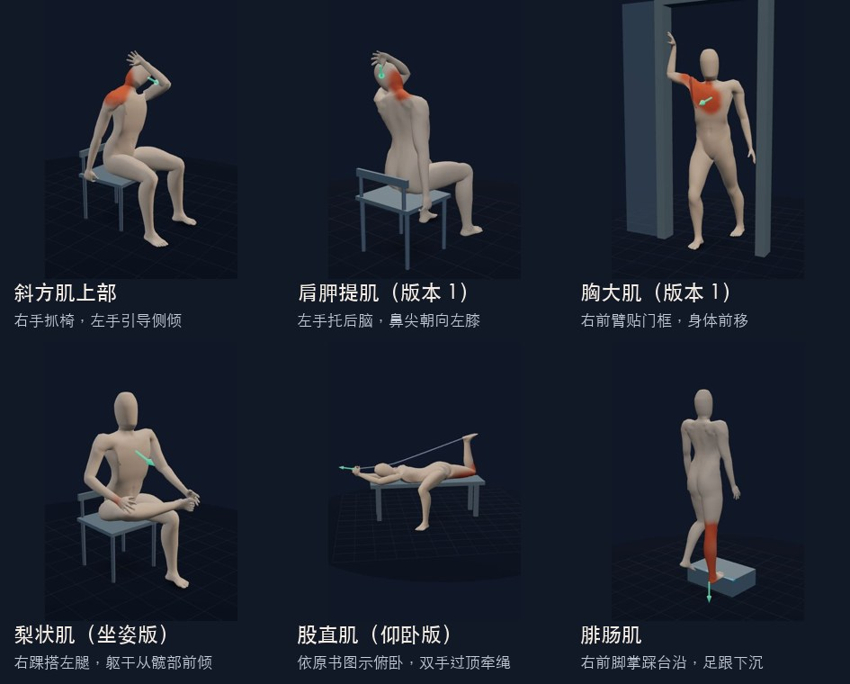

# 《精准拉伸》3D 动作与性能验收

40 个动作都已对照《精准拉伸》原书技术页和图注。每项动作定义都记录了印刷页码、左右侧、支撑点、运动方向、抗阻方式，以及需要贴合的部位和阶段。默认显示体表和目标肌，深层肌群可切换解剖透视。步骤提示随阶段切换，便于一边看支撑点，一边看哪部分身体在动。[分区动作定义](../web/src/data/stretches/)

## 六个代表动作



下表给出生产模型的蒙皮采样结果。距离为正表示两表面之间有间隙，负值表示轻微穿入。采样覆盖保持姿势和阶段过渡，包括抬手接近头部的过程。

| 动作与原书印刷页 | 默认画面中要看清的动作 | 蒙皮采样结果 |
|---|---|---|
| 斜方肌上部，28–29 页 | 右手抓椅边稳定右肩，左手引导头侧倾 | 右手与椅边的间距从原先约 36 mm 改为 −1.0 至 1.4 mm |
| 肩胛提肌（版本 1），36–37 页 | 右手固定椅子，左手托后脑，鼻尖朝向左膝 | 左手穿入头部的最大深度从 9.9 mm 降至 1.0 mm |
| 胸大肌（版本 1），41 页 | 右前臂贴门框，身体前移 | 右手支撑区与门框的间距为 −2.0 至 2.2 mm |
| 梨状肌（坐姿版），76–77 页 | 右踝搭在左腿上，从髋部前倾，左脚着地 | 交叉处间距为 −2.1 至 1.6 mm，左脚底离地 0 至 6.0 mm |
| 股直肌（仰卧版），88–89 页 | 右膝和胸部由凳支撑，左脚着地，双手过顶牵绳 | 右膝附近体表与凳面间距为 0.5 至 1.6 mm，另检查胸部贴凳和左足着地 |
| 腓肠肌，102–103 页 | 右前脚掌踩住台沿，拉伸时足跟下降，抗阻时身体升起 | 前脚掌与台阶的间距为 0.5 至 2.3 mm，抗阻时身体升高约 3.3 cm，落在书中 2.5–5 cm 的范围内 |

**两处原书差异影响了画面。** 股直肌的原书标题是“仰卧版”，第 89 页图示为面朝下撑凳。网站保留原动作名和分享链接，模型与步骤按图示呈现。坐姿腰方肌在第 81 页正文和第 82 页图注中的回升幅度分别约为 1 cm 和 5 cm，演示采用正文幅度。

## 读秒、接触与画面检查

- 34 个动作在抗阻阶段保持姿势。胸锁乳突肌、坐姿胸小肌、坐姿腰方肌、腰大肌和髂肌、股薄肌、腓肠肌这 6 个动作按各自的方向移动。书中给出 5–10 秒范围的抗阻阶段取 6 秒。
- 1 倍速用实际经过的时间计时，进入姿势的过渡单独计时。腓肠肌从拉伸阶段分享链接播放，实测第 13 秒显示剩余 47 秒，第 58 秒剩余 2 秒，随后经过放松进入抗阻。暂停可停在过渡中途，点选步骤则直接显示该步示范姿势。
- 全部 40 项通过动作与接触校验。每项至少检查 105 个地面和实体道具接触样本，重点动作各检查 255 个样本。沿用 5 mm 穿入阈值，手掌、脚底、交叉腿和扶头使用相应的接触区域与间隙检查。覆盖范围是离散姿势和指定接触对，任意两个身体部位之间的连续碰撞仍未穷尽。[全书动作校验](../web/src/scripts/validate40.ts) · [蒙皮接触校验](../web/src/scripts/validateContacts.mjs)
- 桌面、手机竖屏和横屏分别复核 40 个正确示范和 40 个代偿示范，共 240 张默认视角画面。另验证了拖动镜头、解剖透视、阶段直达和动作分包延迟时连续切换三个链接的最终选择。

## 同机生产构建对比

在同一台 arm64 Mac 上，用 Chrome 157 无头模式访问本地生产构建，无网络限速，设备像素比为 1。每个视口创建 5 个独立浏览器上下文，取首屏耗时中位数。“步骤可读”记录步骤文字写入页面的时间，“完整人体可见”记录正式人体网格首次提交绘制的时间。手机两行使用触控视口模拟，尚未在手机硬件上测量。

| 视口 | 步骤可读，旧 → 新 | 完整人体可见，旧 → 新 | 播放并转动镜头时 P95 帧间隔，旧 → 新 | 暂停稳定后 1.1 秒内绘制帧数，旧 → 新 |
|---|---:|---:|---:|---:|
| 桌面 1440 × 900 | 51 → 39 ms | 163 → 111 ms | 17.6 → 17.3 ms | 66 → 0 |
| 竖屏 390 × 844 | 46 → 36 ms | 126 → 104 ms | 17.5 → 17.4 ms | 66 → 0 |
| 横屏 844 × 390 | 46 → 35 ms | 129 → 97 ms | 17.4 → 16.9 ms | 66 → 0 |

旧版在桌面连续切换 40 个动作、回到同一动作和姿势后，WebGL 缓冲对象从 492 增至 1,364；竖屏和横屏分别增至 1,380 和 1,376。新版三个视口都从 434 回到 434，纹理均从 5 回到 5。这里统计仍存活的 WebGL 对象个数，显存字节数尚未测量。

入口 JavaScript 从 906.84 kB 降至 39.54 kB，gzip 后从 232.70 kB 降至 11.79 kB。目录和步骤可以先显示，3D 引擎和当前区域并行加载。另行加载的舞台脚本为 640.50 kB（gzip 后 166.96 kB），人体模型为 670.80 kB。播放时 P95 帧间隔变化较小，主要收益体现在首次显示、暂停和反复切换动作。

## 复测

在 `web/` 下运行 `npm run validate` 和 `npm run build`。如本机 Node 可加载 Playwright，并有对应的 Chromium，可执行以下命令。脚本会临时启动本地静态服务，按视口打印冷启动各次记录、帧间隔、暂停帧数和资源计数。也可用环境变量 `CHROME_BIN` 指定本机 Chrome 路径。[测量脚本](../web/scripts/profile_viewer.cjs)

```sh
node scripts/profile_viewer.cjs dist
# 第二个参数可选，用来保存 240 张画面
node scripts/profile_viewer.cjs dist /tmp/stretch-viewer-captures
```
