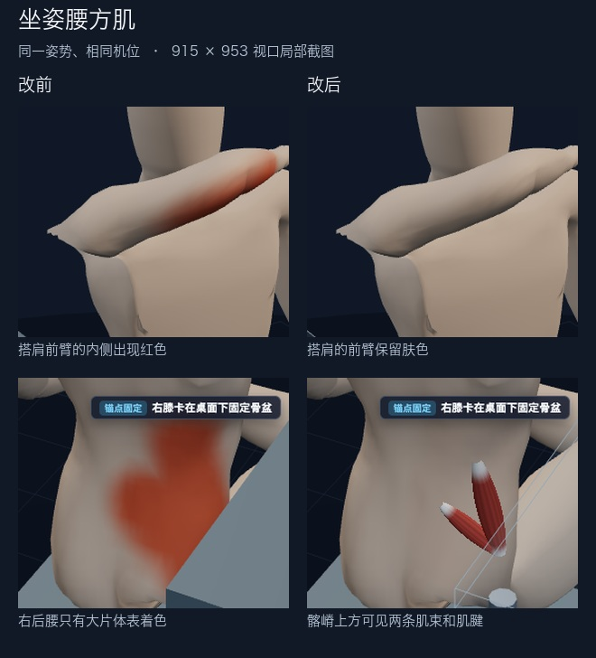

# 全书肌束显示验收

本次以提交 `7c39257` 的生产构建为对照。旧版按中立站姿下的空间距离为整张人体网格着色。手臂下垂时与后腰靠得很近，抬手搭肩后，错误的颜色仍留在右臂。坐姿腰方肌旧版有 60 个右上臂顶点、91 个右前臂顶点混入至少 10% 的目标色。新版逐个检查全部 11,901 个体表顶点，双臂和双手进入腰方肌透视选区的顶点均为 0。



对象、姿势和相机参数在每行前后对照中相同。截图取自 915 × 953 浏览器视口，两行采用前后两个观察角度。新版默认机位从右后上方显示两条腰方肌，半透明桌面能同时交代右膝与桌板的位置。红色肌腹与浅色肌腱随骨架移动。全身深层透视继续展示骨骼、肌束起止点及相邻神经。

## 验证方法

- **解剖归属。** 对每条目标肌束独立检查蒙皮权重所属身体部位、左右侧以及目标区是否有连续覆盖。全书 40 项的区外顶点均为 0。另验证了模型延迟加载、握拳后切换动作、返回原动作及透视模式切换后，腰方肌的选区仍一致。这个数字对应表面的解剖选区。[网格回归检查](../web/src/scripts/validateWindows.mjs)
- **实际画面。** 保持镜头、姿势、道具和标签相同，分别绘制全部肌束、移除单条肌束及移除全部肌束的画面，比较浏览器画布。任一 RGB 通道差值达到 8/255 计作一个变化像素。每个默认机位的正确和代偿示范均验证有目标肌显示，并逐条验证每一束会对画面产生独立贡献。此项度量画面可见性，肌肉保留现有解剖示意模型的表现精度。[浏览器回归检查](../web/scripts/check_muscle_views.cjs)
- **角色与遮挡。** 同时作为目标的臀中肌与臀小肌分别显示，坐姿梨状肌的两束和邻近坐骨神经按各自角色显示。调整了两版梨状肌、两版腰方肌等动作的默认观察角度，避免手臂、椅背或桌板把目标肌完全遮住。全部 40 项的原有动作、支撑、接触检查及生产构建均通过。

### 用户标注视口中的坐姿腰方肌

数值为分别隐藏每束后发生变化的像素数。右臂搭在左肩的姿势贯穿整个测试。

| 阶段 | 髂嵴至第 12 肋束 | 髂嵴至腰椎横突束 |
|---|---:|---:|
| 起始定姿 | 423 | 230 |
| 初次拉伸 | 664 | 250 |
| 抗阻 | 787 | 261 |
| 放松加深 | 718 | 237 |
| 代偿示范 | 634 | 269 |

## 40 项逐项结果

每个视口检查两张画面，分别为默认机位的正确拉伸和错误代偿。后三列列出这两张中较小的目标肌可见像素数。不同视口的身体显示尺寸不同。三组共检查 240 张，另有上述 5 张腰方肌阶段画面。[桌面检查图](images/肌束检查-桌面.jpg) · [手机竖屏检查图](images/肌束检查-竖屏.jpg) · [手机横屏检查图](images/肌束检查-横屏.jpg)

| 编号 | 动作 | 目标束数 | 区外顶点 | 桌面 1440 × 900 | 竖屏 390 × 844 | 横屏 844 × 390 |
|---:|---|---:|---:|---:|---:|---:|
| 01 | 斜方肌上部 | 3 | 0 | 935 | 540 | 123 |
| 02 | 胸锁乳突肌 | 2 | 0 | 353 | 191 | 47 |
| 03 | 斜角肌群 | 2 | 0 | 711 | 425 | 99 |
| 04 | 枕下肌群 | 2 | 0 | 262 | 157 | 37 |
| 05 | 肩胛提肌（版本1） | 2 | 0 | 227 | 131 | 28 |
| 06 | 肩胛提肌（版本2） | 2 | 0 | 181 | 106 | 24 |
| 07 | 胸大肌（版本1） | 3 | 0 | 989 | 587 | 132 |
| 08 | 胸大肌（版本2） | 4 | 0 | 442 | 258 | 59 |
| 09 | 胸小肌（站姿版） | 2 | 0 | 348 | 188 | 44 |
| 10 | 胸小肌（坐姿版） | 2 | 0 | 576 | 337 | 79 |
| 11 | 斜方肌中部和菱形肌（站姿版） | 2 | 0 | 3154 | 875 | 850 |
| 12 | 斜方肌中部和菱形肌（坐姿版） | 2 | 0 | 867 | 518 | 115 |
| 13 | 背阔肌（站姿版） | 2 | 0 | 1902 | 1103 | 246 |
| 14 | 背阔肌（坐姿版） | 2 | 0 | 3191 | 1302 | 418 |
| 15 | 冈下肌（版本1） | 2 | 0 | 295 | 181 | 39 |
| 16 | 冈下肌（版本2） | 2 | 0 | 439 | 264 | 59 |
| 17 | 大圆肌 | 1 | 0 | 518 | 290 | 75 |
| 18 | 冈上肌（版本1） | 1 | 0 | 643 | 389 | 89 |
| 19 | 冈上肌（版本2） | 1 | 0 | 640 | 373 | 80 |
| 20 | 臀大肌 | 2 | 0 | 952 | 555 | 124 |
| 21 | 臀中肌和臀小肌 | 2 | 0 | 487 | 290 | 66 |
| 22 | 梨状肌（站姿版） | 1 | 0 | 217 | 125 | 26 |
| 23 | 梨状肌（坐姿版） | 2 | 0 | 449 | 265 | 60 |
| 24 | 腰方肌（卧姿版） | 2 | 0 | 1195 | 301 | 319 |
| 25 | 腰方肌（坐姿版） | 2 | 0 | 2655 | 1072 | 340 |
| 26 | 腰大肌和髂肌（髋屈肌） | 2 | 0 | 911 | 238 | 210 |
| 27 | 股直肌（仰卧版） | 1 | 0 | 856 | 230 | 183 |
| 28 | 股直肌（跪姿版） | 1 | 0 | 2725 | 908 | 364 |
| 29 | 阔筋膜张肌 | 1 | 0 | 1464 | 847 | 195 |
| 30 | 腘绳肌群 | 2 | 0 | 1829 | 538 | 248 |
| 31 | 耻骨肌、长收肌和短收肌（短内收肌群） | 3 | 0 | 939 | 551 | 123 |
| 32 | 股薄肌（长内收肌） | 1 | 0 | 749 | 295 | 98 |
| 33 | 腓肠肌 | 2 | 0 | 1274 | 744 | 171 |
| 34 | 比目鱼肌 | 1 | 0 | 1087 | 622 | 145 |
| 35 | 胫骨前肌 | 1 | 0 | 909 | 502 | 127 |
| 36 | 肱二头肌 | 2 | 0 | 795 | 436 | 101 |
| 37 | 肱三头肌 | 2 | 0 | 869 | 506 | 122 |
| 38 | 前臂屈肌群 | 2 | 0 | 502 | 292 | 70 |
| 39 | 前臂伸肌群 | 2 | 0 | 568 | 340 | 82 |
| 40 | 桡侧腕长伸肌和桡侧腕短伸肌 | 2 | 0 | 598 | 365 | 85 |

## 同机生产构建性能

同一台 arm64 Mac、Chrome 157、设备像素比 1、本地服务。移动端两行采用触控视口模拟。P95 为播放并连续转动镜头四秒时呈现到屏幕的帧间隔。首屏记录五个独立浏览器上下文的中位数。

| 视口 | P95 旧 → 新 | 暂停稳定后 1.1 秒内的帧数 | 完整人体首次绘制，旧 → 新 |
|---|---:|---:|---:|
| 桌面 | 17.5 → 17.6 ms | 0 | 112 → 131 ms |
| 竖屏 | 17.6 → 17.4 ms | 0 | 95 → 113 ms |
| 横屏 | 17.5 → 17.5 ms | 0 | 101 → 114 ms |

加入局部透视后，三个视口在首个动作上均使用 449 个 WebGL 缓冲对象和 7 张纹理，切换全部 40 项再回到同一姿势后仍为 449 和 7。旧版是 434 个缓冲对象和 5 张纹理。新增资源用于目标肌束与透视图层。完整人体首次绘制多用 13–19 毫秒，最大 P95 帧间隔增幅约 0.6%，低于本次 10% 的验收上限。以上为同机浏览器测量，手机硬件性能尚未实测。[性能测量脚本](../web/scripts/profile_viewer.cjs)

## 复测

在 `web/` 运行 `npm run validate`、`npm run build`。启动生产预览后，在可加载 Playwright 和 Chromium 的 Node 环境执行以下命令。`CHROME_BIN` 可指定本机 Chrome 路径。浏览器检查的第二个参数可选，用于存放截图。

```sh
npm run preview -- --port 4174 --strictPort
# 在另一终端执行
node scripts/check_muscle_views.cjs http://127.0.0.1:4174/ /tmp/stretch-muscle-review
node scripts/profile_viewer.cjs dist
```
